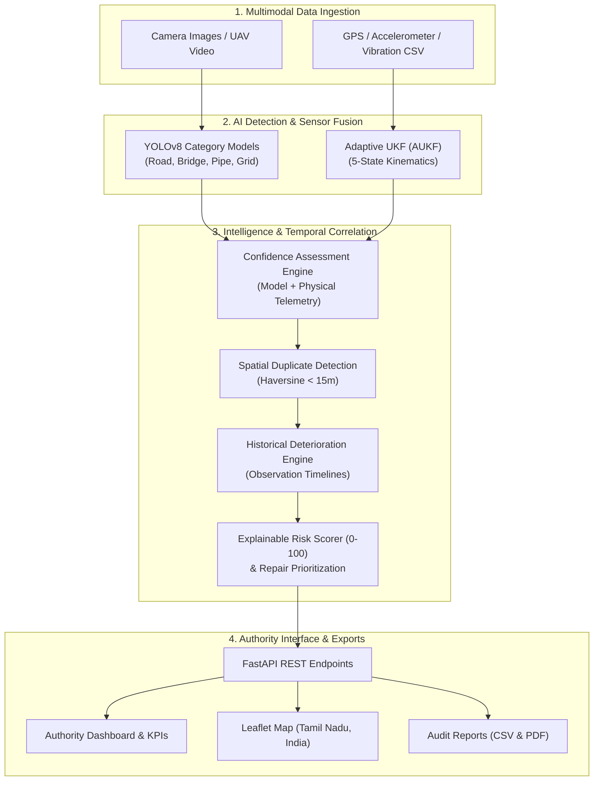
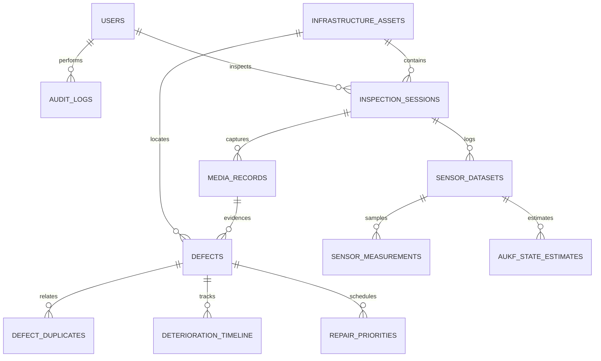

# InfraGuard System Architecture & Data Flow

## 1. High-Level Architecture

InfraGuard is an end-to-end, authority-focused AI platform designed for predictive infrastructure maintenance across Roads, Bridges, Pipelines, and Power Grids.



---

## 2. Component Directory Architecture

```
infraguard/
├── frontend/                     # Pure HTML5 / CSS3 / JavaScript
│   ├── index.html                # Authority Dashboard
│   ├── pages/                    # 10 Dedicated Module Interfaces
│   ├── css/                      # Pastel Theme, Dashboard & Responsive Styles
│   └── js/                       # Unified API Client & Module Scripts
├── backend/                      # Python FastAPI Architecture
│   └── app/
│       ├── main.py               # Application entrypoint & static mount
│       ├── api/                  # Auth, Detection, Sensors, Infra, Risk, Reports
│       ├── models/               # SQLAlchemy ORM Schema Definitions
│       ├── schemas/              # Pydantic v2 Serialization Models
│       ├── database/             # SQLite WAL connection & seeder
│       ├── detection/            # Model loader & video frame extractor
│       ├── sensor_fusion/        # 5-State Adaptive Unscented Kalman Filter
│       ├── services/             # Duplicate detection, Deterioration, Risk
│       ├── reporting/            # RFC 4180 CSV & ReportLab PDF generators
│       └── security/             # PBKDF2 Password Hashing & HS256 JWT
├── data/                         # Uploads, processed imagery & datasets
├── models/                       # Model documentation & weights directory
├── tests/                        # Full Pytest Test Suite
└── docs/                         # Technical documentation & formulations
```

---

## 3. Database Entity Relationship Model


